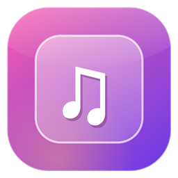
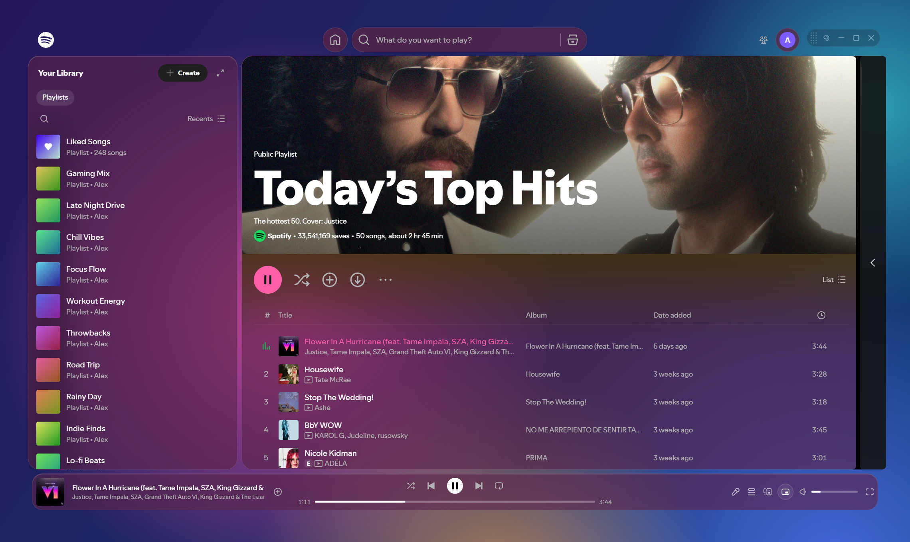
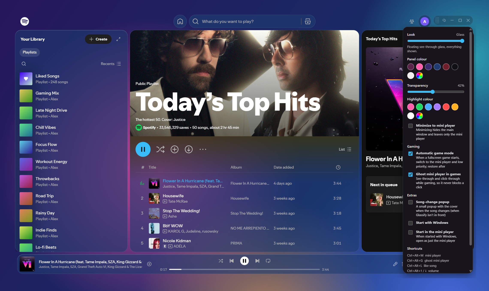
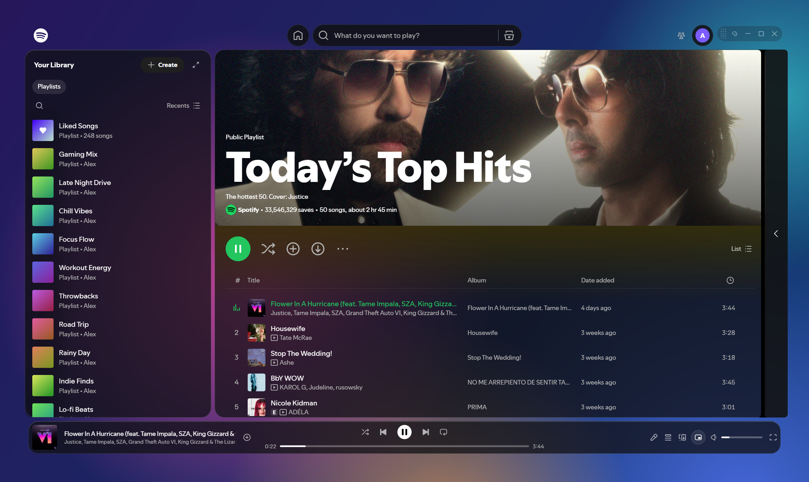
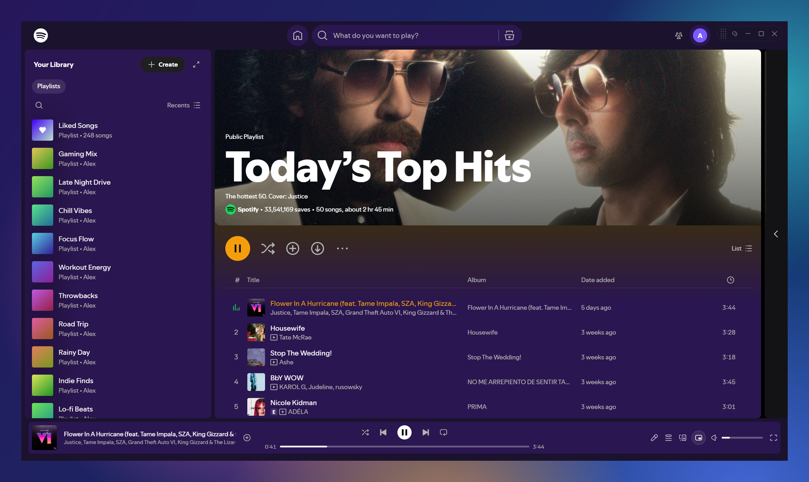
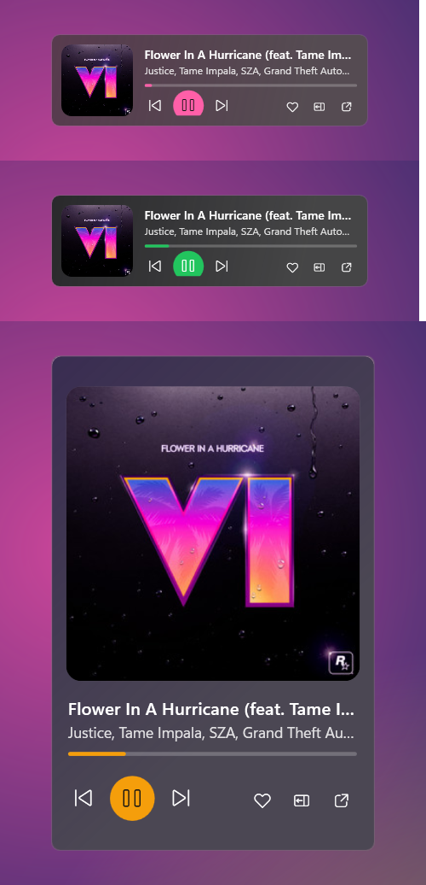

<p align="center"></p>

# Glassify

A light, floating, glass-styled Windows player for Spotify. It runs Spotify's own web player (so playback,
your library and Premium all work normally) inside a minimal see-through window, with a floating mini player
and features for listening while gaming.

## Download
Get **[the latest release](https://github.com/ilyvbrdn/Glassify/releases/latest)**, extract the zip to a folder
you can write to (not Program Files) and run `Glassify.exe`. On first launch Windows may show
"Windows protected your PC": click **More info → Run anyway** (the app isn't code-signed).

## Why Glassify?
The official Spotify app for Windows is heavy: it is slow to open, keeps using CPU and memory in the
background and is hard to keep out of the way while you play games. Glassify is a lighter shell around
Spotify's own web player. It opens quickly, drops to low priority when you're not looking at it, shrinks to
a tiny always-on-top mini player, and switches to a click-through "ghost" mini player by itself when a
fullscreen game starts. You also choose how it looks: see-through glass, solid or light, in any colours.

## Screenshots
| | |
|---|---|
|  **Glass** |  **Settings (gear menu)** |
|  **Glass focused** |  **Solid** |
|  **Light (lightest on CPU)** |  **Mini player in three colours** |
|  **Ghost mini player (while gaming)** | |

Screenshots use a demo library; your own playlists are never part of the app or this repo.

## Features
- **Look slider** (gear menu): Glass, Glass focused, Solid, Light. Light is the lightest on CPU.
- **Colours**: panel colour, transparency and highlight colour.
- **Mini player**: always on top, cover art, play/pause/next/previous, like, click the bar to seek,
  mouse wheel for volume, three sizes, button to open the main player.
- **Minimize to mini player**: minimizing hides the main window and leaves only the mini player.
- **Automatic game mode**: when a fullscreen game starts, switches to the mini player and low priority;
  restores everything when the game closes.
- **Ghost mini player**: see-through and click-through while gaming (Ctrl+Alt+G any time).
- **Song-change popup** (optional), **start with Windows** (optional, can start straight into the mini player).
- **Crash recovery**: if Spotify's page crashes it reloads and keeps playing.
- **One-click updates**: checks this repo's latest GitHub Release once a day; one click installs it and
  restarts, keeping your login, settings and music.

## Shortcuts
| Keys | Action |
|---|---|
| Ctrl+Alt+M | show / hide mini player |
| Ctrl+Alt+G | ghost (click-through) mini player |
| Ctrl+Alt+L | like current song |
| Ctrl+Alt+Up / Down | volume |
| Media keys | play/pause, next, previous |

## Requirements
Windows 10 or 11 with the Microsoft Edge WebView2 Runtime (built into Windows 11) and .NET Framework 4.8
(built into Windows 10/11). A Spotify Premium account.

## Building
```
dotnet build app/Glassify.csproj -c Release -o build
powershell -ExecutionPolicy Bypass -File tools/install.ps1
```
`install.ps1` installs to `%USERPROFILE%\Glassify`, adds Start menu and Desktop shortcuts and starts it.
The icon is generated by `tools/make-icon.ps1` (writes `app/app.ico`, plus `icon-preview.png`, a local
sheet for checking every size, which isn't committed).
Your login and settings live in a `data` folder next to the exe. **Never share or commit `data`.**

## Releasing an update
1. Bump `Version` in `app/Program.cs` and `app/Glassify.csproj`.
2. Build, then zip a `Glassify` folder holding `Glassify.exe`, its DLLs, the `runtimes` folder and `theme.css`
   (never `data`).
3. Create a GitHub Release with a higher tag (like `v1.1.0`) and attach the zip.

Running copies check once a day and show an update button (top right). One click downloads the zip from this
repo's releases, checks it against GitHub's SHA-256 fingerprint, swaps the program files (the `data` folder with
the login and settings is never touched) and restarts with the music still playing. If anything goes wrong it
puts the old files back and opens the release page instead. If Glassify can't write to its own folder (for
example under Program Files) the button just opens the release page.

## Notes
Not affiliated with Spotify. Uses Spotify's official web player unmodified (no ad blocking, no downloading,
no DRM changes); Glassify only changes the look and window.
