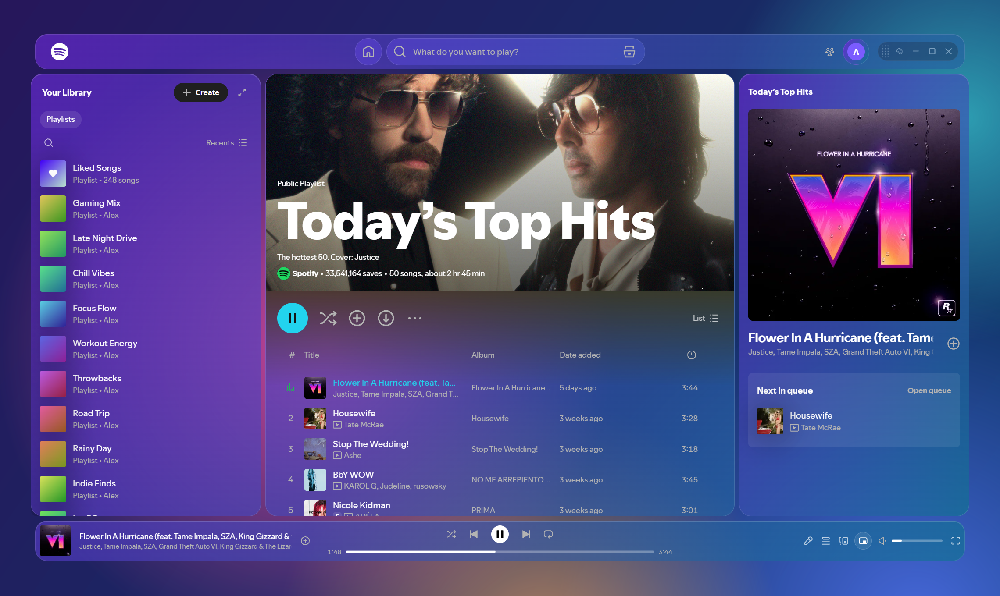
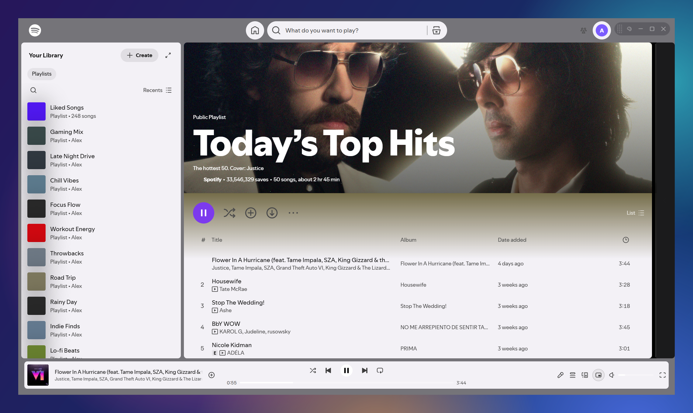
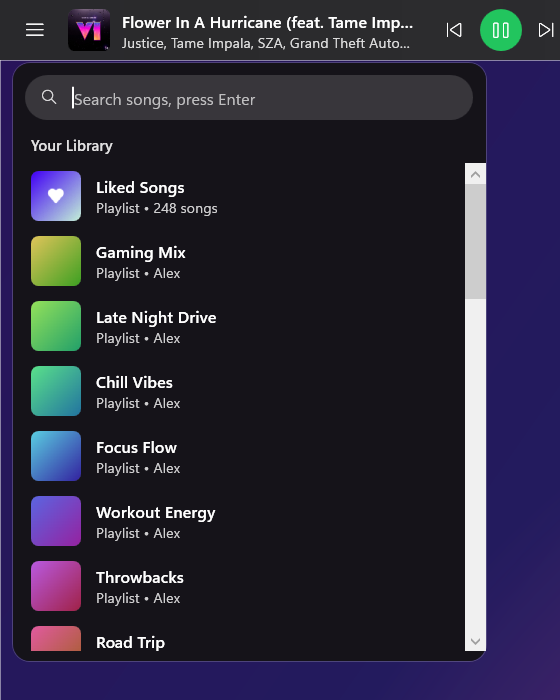
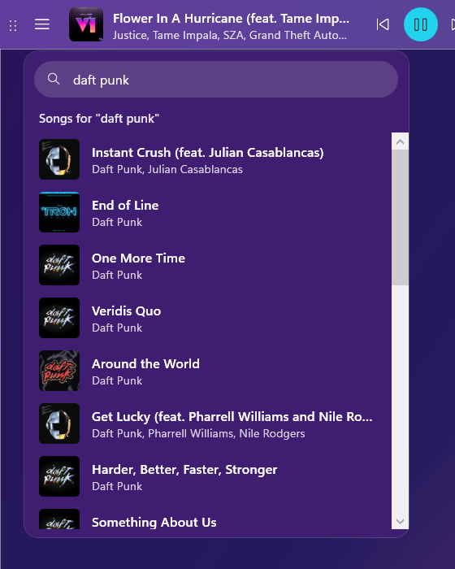
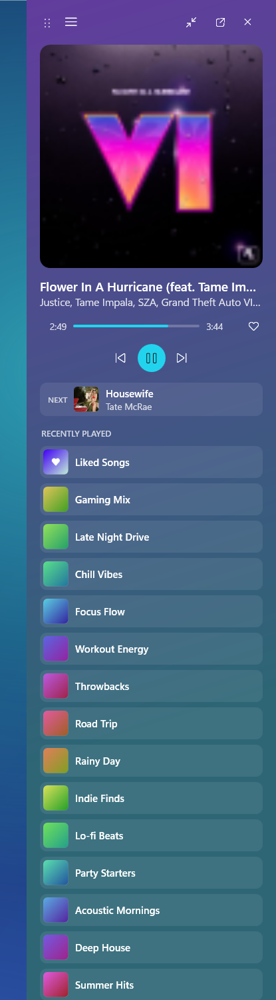
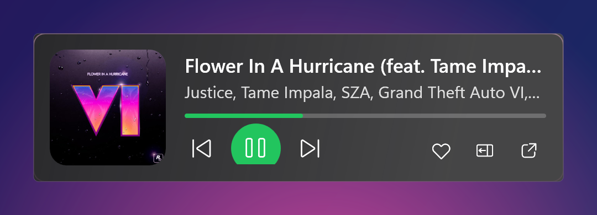
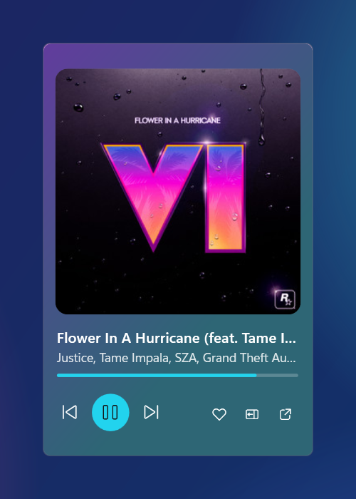
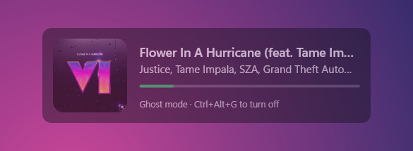

<p align="center"></p>

# Glassify

A floating, glass-styled Windows player for Spotify. It runs Spotify's own web player (so playback,
your library and Premium all work normally) inside a minimal see-through window, with a player you can shrink
into a floating card or dock to the edge of your screen, and features for listening while gaming.

**Website: [ilyvbrdn.github.io/Glassify](https://ilyvbrdn.github.io/Glassify/)**



## Download
Get **[the latest release](https://github.com/ilyvbrdn/Glassify/releases/latest)**, extract the zip to a folder
you can write to (Documents or Downloads, not Program Files) and run `Glassify.exe`. Sign in to Spotify
(Premium needed). On first launch Windows may show "Windows protected your PC": click
**More info → Run anyway** (the app isn't code-signed). After that it updates itself.

## Why Glassify?
It's still Spotify, just yours and out of the way. Glassify runs Spotify's own web player, so your library,
playlists and Premium work exactly as usual; what changes is how it looks and how it behaves around everything
else you do:
- **Make it look like yours.** Spotify's app looks the same for everyone. Glassify puts it under see-through
  glass in your colours, a gradient, or a calm solid look.
- **Keep it in reach, not in the way.** Fold it into a small always-on-top player or a bar on the edge of your
  screen; minimize or close it and the music keeps going there.
- **Built around gaming.** When a fullscreen game starts, Glassify hides, drops to low priority so the game comes
  first, and leaves a click-through player. Close the game and it comes back.

It opens in about 3 seconds and stays at low priority while it's in the background. Because it runs Spotify's web
player, it uses about as much memory as a browser tab playing Spotify (around 500 MB on our test PC).

## How it looks
| | |
|---|---|
|  **Glass**: floating see-through panels |  **Settings**: the gear menu, in four tabs |
|  **Solid**: a normal window, any colour |  **Light**: the lightest on your PC |

## The player: a card or a bar
**The bar** docks to the top of your screen with the song, a timeline, next in queue and your recently played playlists:


| | | |
|---|---|---|
|  **Its menu**: your library |  **...and song search** |  **On the left or right** it becomes a sidebar |
|  **The mini player**, any size: wide... |  **...or tall** with a big cover |  **Ghost mode** while gaming: see-through and click-through |

Screenshots use a demo library; your own playlists are never part of the app or this repo.

## Features, explained

### Looks and colours (Settings > Look)
- **Look slider: Glass, Solid, Light.** Glass is the floating see-through style. Solid is a normal opaque
  window (cheaper to draw). Light is the lightest look: one flat colour, no cover art in lists,
  animations paused, low priority. Every button still works in every look.
- **Panel colour** from the swatches or any colour you pick, and **transparency** for the glass.
- **Gradient**: blend the panel colour into a second colour, at any **angle**, with a **balance** slider for
  which colour dominates (it snaps to the middle, double-click resets). One continuous gradient runs across
  the whole window, the search box and home button included, and the mini player and bar follow it.
- **Highlight colour** instead of Spotify green (play buttons, the song that's playing, progress bars).
- **Top bar background**: an optional glass bar behind the search box and window buttons, matching the
  panels or with its own colour and transparency.
- Light colours automatically get dark text, so everything stays readable.

### One player, two shapes (Settings > Player)
- **Mini player**: a small always-on-top card with the cover, song, controls, like button and a seek bar.
  Drag any edge or corner to any size; tall gives a big cover. Mouse wheel changes the volume.
- **Bar**: docks to the **top, bottom, left or right** edge of **any screen** (drag its grip to an edge, or
  pick the position and screen in Settings). Other windows make room for it, like the taskbar, and it steps
  aside for fullscreen games. It shows the song, a timeline with the like button, **next in queue** (click to
  skip to it) and your **recently played** playlists (click to play). On the left or right it becomes a
  sidebar with a big cover. Its **menu** lists your whole library and **searches songs**. It adapts to any
  screen, from laptops to ultra-wides.
- **Ctrl+Alt+B** (or the shape button) turns one shape into the other; Ctrl+Alt+M shows or hides it.
- **Minimize or close to the player**: with this on, the – and × buttons hide the main window and leave the
  player playing. Quit from the Glassify icon by the clock (or Alt+F4). Hiding the player too leaves Glassify
  on the taskbar, so it never looks closed.

### Gaming (Settings > Gaming)
- **Automatic game mode**: when a fullscreen game starts, Glassify hides the main window, shows the player and
  drops to low priority so the game comes first; everything comes back when the game closes. Browsers,
  fullscreen videos and screenshot tools don't count as games.
- **Ghost mini player**: during games the mini player turns see-through and click-through, so it never blocks
  a click (Ctrl+Alt+G any time).

### Everything else (Settings > More)
- **Song-change popup** (optional): a small popup with the cover when the song changes and Glassify isn't in front.
- **Start with Windows** (optional), and **start in the mini player** if you like.
- **Automatic updates**: checks for a new version a few seconds after starting and every 2 hours, installs it
  in seconds with your music still playing, and never during a game. Your login and settings are kept. Can be
  switched off; then an update button installs it in one click.
- **Crash recovery**: if Spotify's page crashes, Glassify reloads it and keeps playing.
- **Quiet in the background**: low priority and the browser engine's memory-saver mode whenever Glassify is
  minimized or a game is running.

## Shortcuts
| Keys | Action |
|---|---|
| Ctrl+Alt+M | show / hide the player |
| Ctrl+Alt+B | switch the player between mini player and bar |
| Ctrl+Alt+G | ghost (click-through) mini player |
| Ctrl+Alt+L | like the current song |
| Ctrl+Alt+Up / Down | volume |
| Media keys | play/pause, next, previous |

## Requirements
Windows 10 or 11 with the Microsoft Edge WebView2 Runtime (built into Windows 11) and .NET Framework 4.8
(built into Windows 10/11). A Spotify Premium account.

## Building
```
dotnet build app/Glassify.csproj -c Release -o build
powershell -ExecutionPolicy Bypass -File tools/install.ps1
```
`install.ps1` installs to `%USERPROFILE%\Glassify`, adds Start menu and Desktop shortcuts and starts it.
The icon is generated by `tools/make-icon.ps1` (writes `app/app.ico`, plus `icon-preview.png`, a local
sheet for checking every size, which isn't committed).
Your login and settings live in a `data` folder next to the exe. **Never share or commit `data`.**

## Releasing an update
GitHub builds and publishes releases itself (`.github/workflows/release.yml`), so a fix can go out from any
device, a phone included, without a Windows PC:
1. Commit the fix to `main`.
2. Raise the version in **both** `app/Program.cs` (`Version = "1.2"`) and `app/Glassify.csproj`
   (`<Version>1.2.0</Version>`). Use a higher number than the current release.
3. Rewrite the top of `.github/release-notes.md` ("New in 1.2") and change the zip name in it.
4. Commit, push, then push a tag that matches the version: `git tag v1.2` and `git push origin v1.2`.

GitHub then builds Glassify on Windows, refuses to publish if the tag doesn't match the version in both files or
isn't newer than the current release, packages the zip (`Glassify.exe`, its DLLs, the `runtimes` folder,
`theme.css` and `tools/HOW TO START.txt`, never `data`), publishes the release and removes the older ones. Follow
it in the Actions tab. To test a build without publishing anything, run "Build and release" by hand from the
Actions tab: the zip is attached to the run.

Running copies check a few seconds after starting and every 2 hours, then install it automatically (or, with
automatic updates off, show an update button at the top right). The update downloads the zip from this
repo's releases, checks it against GitHub's SHA-256 fingerprint, swaps the program files (the `data` folder with
the login and settings is never touched) and restarts with the music still playing. If anything goes wrong it
puts the old files back. If Glassify can't write to its own folder (for example under Program Files) the
button just opens the release page.

## Notes
Not affiliated with Spotify. Uses Spotify's official web player unmodified (no ad blocking, no downloading,
no DRM changes); Glassify only changes the look and window.

---

<p align="center">
  <b>Like Glassify? Give it a ⭐ star at the top of this page.</b><br>
  It helps other people find it, and bug reports and ideas are welcome in
  <a href="https://github.com/ilyvbrdn/Glassify/issues">Issues</a>.
</p>
